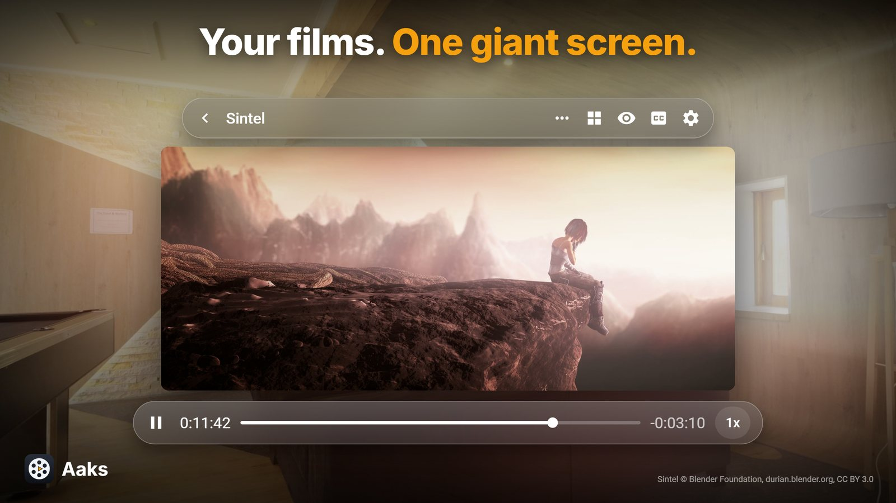
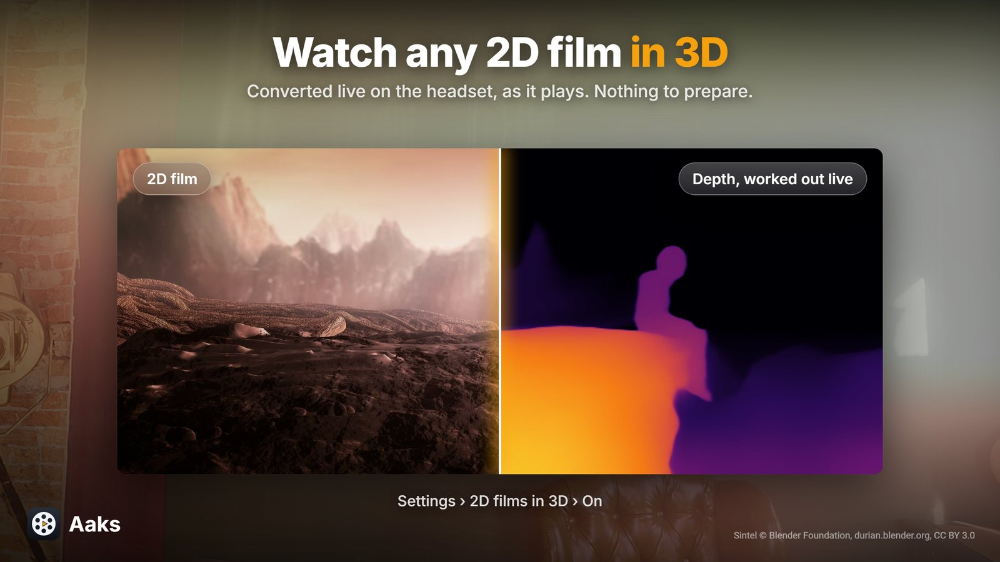
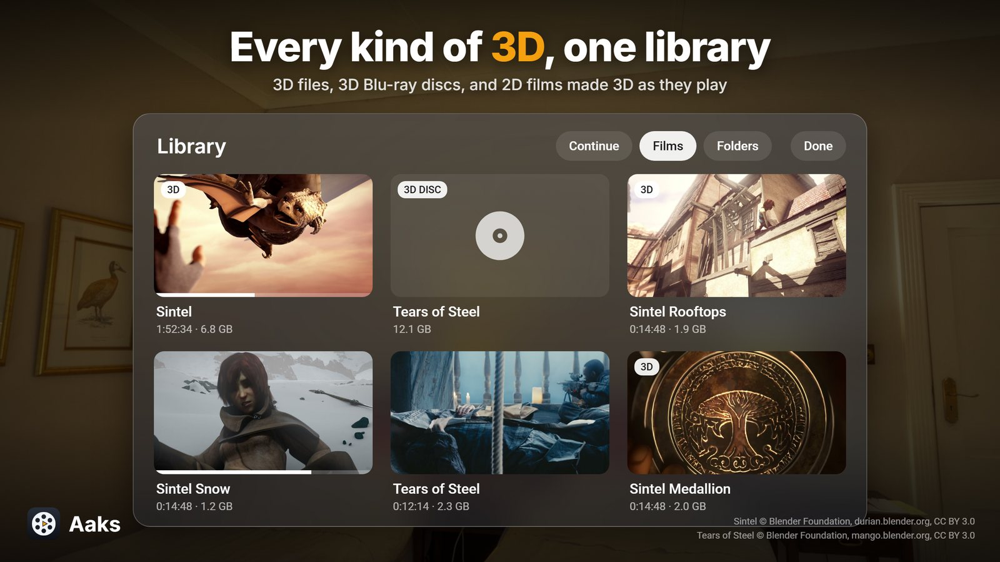
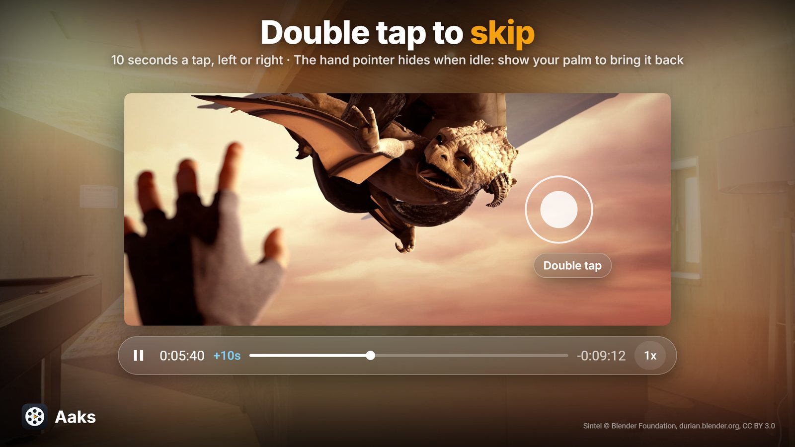
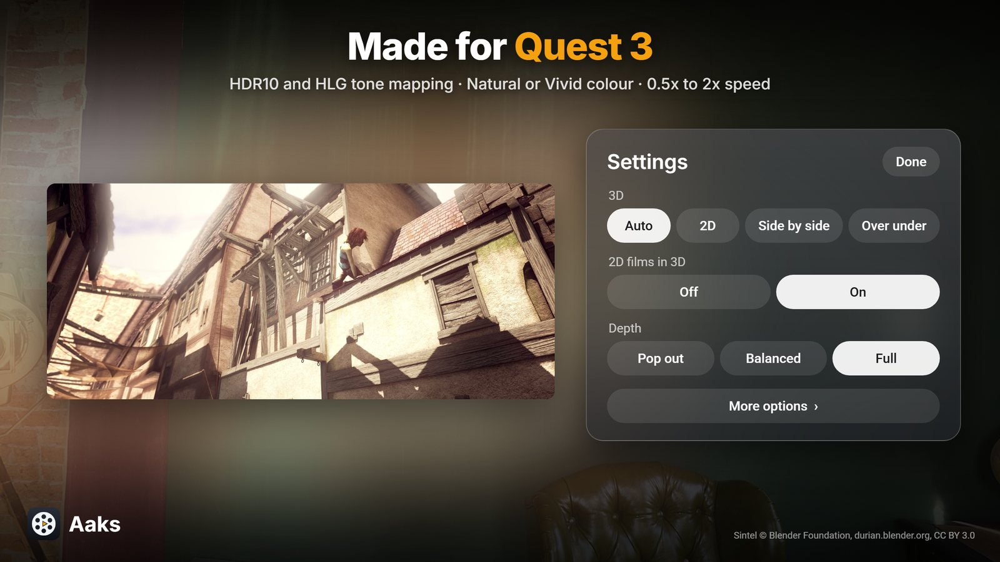

  

# Aaks

A 3D movie player for the Meta Quest 3, running as a native OpenXR app. It plays side by side and
over under 3D files, 3D Blu-ray disc images, and ordinary 2D films, which it can turn into 3D as
they play.

## What it does

- Plays video files through Media3, with TrueHD and DTS sound decoded in the app.
- Plays 3D Blu-ray ISOs: the MVC video decoded on the headset, Dolby and DTS sound, PGS subtitles.
- Turns a 2D film into 3D while it plays, with the ZipDepth depth model on the headset's GPU.
- Shows HDR10 and HLG films tone mapped for the headset's screen, with Natural and Vivid colours.
- Plays at 0.5x to 2x, the sound keeping its pitch, and shows where a skip will land.
- Styled subtitles with their own depth and sync, a curved screen, and passthrough or a dark room.
- Double tap the left or right of the picture to skip 10 seconds back or forward.
- Hand tracking: the pointer hides when the hand is idle; show an open palm to bring it back.

## Watch any 2D film in 3D, live

No conversion step and nothing to wait for: Aaks estimates depth on the headset as the film plays
and shows each frame in 3D.

1. Open a regular 2D film from the library.
2. Open **Settings** on the control bar.
3. Set **2D films in 3D** to **On**. The setting is remembered for every 2D film after that.

## Screenshots

| | |
|---|---|
|  |  |
|  |  |

## Building

Requires Android Studio with the NDK. Debug build:

    ./gradlew assembleDebug

The APK lands in `app/build/outputs/apk/debug/`. Install it with `adb install -r`. The app
is `com.aaks.player`, and the debug build `com.aaks.player.debug`.

### Tests

The parts of the renderer with no GL, OpenXR or Android in them build and run on a desktop with any
C compiler, and the Java side has plain unit tests:

    make -C app/src/test/cpp test
    ./gradlew testDebugUnitTest

Release builds are signed when `keystore.properties` exists; see `keystore.properties.example`.

## Licence

GPLv3 (see `LICENSE.txt`). Third-party credits and licences are in [CREDITS.md](CREDITS.md).
