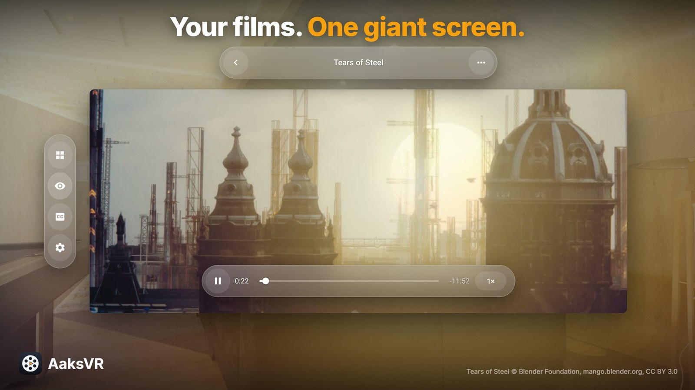
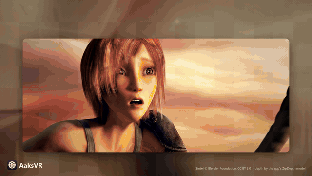
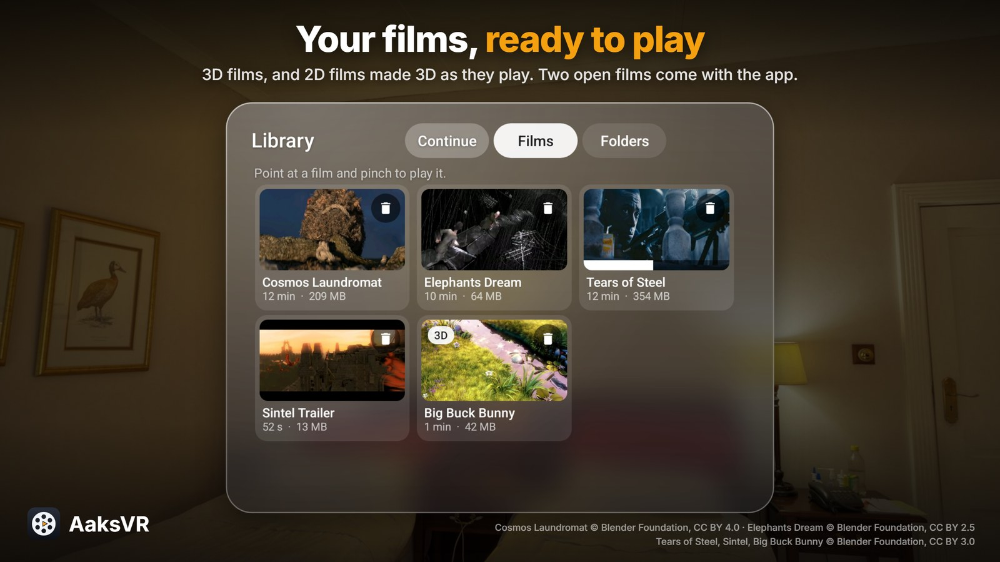
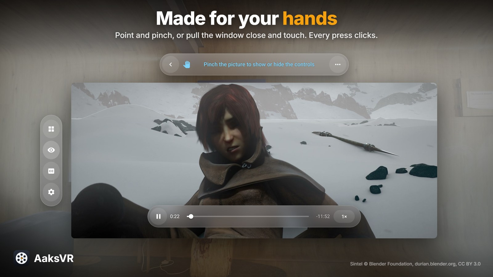
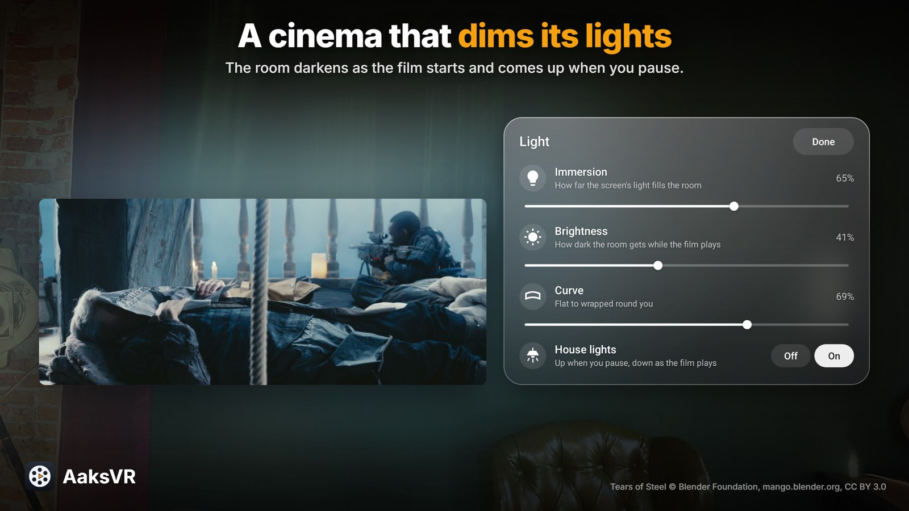
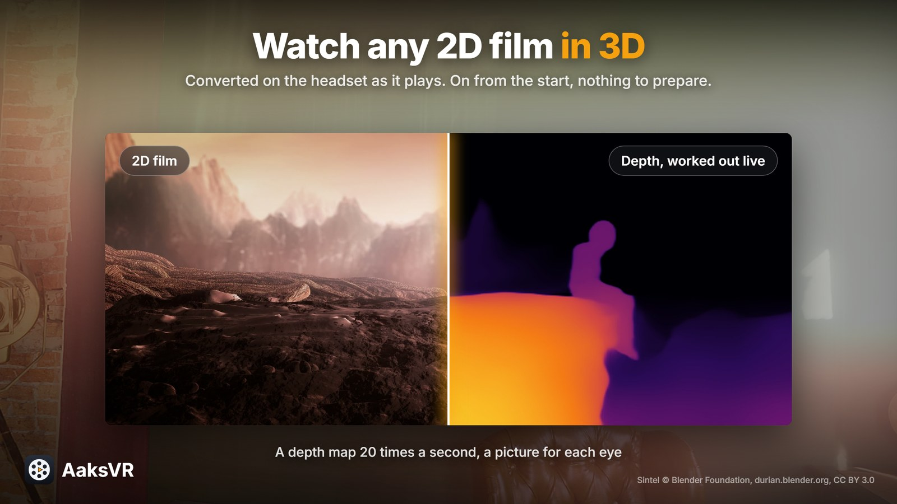

  

# AaksVR

A 3D movie player for the Meta Quest 3 and 3S, running as a native OpenXR app. It plays side by
side and over under 3D files, 3D Blu-ray disc images, and ordinary 2D films, which it turns into 3D
as they play. Everything works with your hands alone, or with controllers.

## Install

1. Download the latest `AaksVR-*.apk` from [Releases](https://github.com/jashwanth176/aaks-player/releases).
2. Turn on Developer Mode for your Quest in the Meta Horizon phone app.
3. Install the APK with [SideQuest](https://sidequestvr.com) or `adb install AaksVR-*.apk`.
4. On the headset, open AaksVR from **Library > Unknown Sources**.

Two short films come with it, one in 3D and one in 2D, so there is something to watch straight
away. To see your own, press **Allow** in the library and let AaksVR see the videos on the headset.
Copy films to the headset's `Movies` or `Download` folder.

## Watch any 2D film in 3D, live

No conversion step and nothing to wait for: AaksVR estimates depth on the headset as the film plays
and shows each frame in 3D.

*Click for the full-quality video.*

It is on from the start: open any 2D film from the library and it plays in 3D. To watch a film
flat, open **Settings** on the rail beside the screen and set **2D films in 3D** to **Off**; the
setting is remembered.

## Screenshots

| | |
|---|---|
|  |  |
|  |  |

## Features

### Every kind of 3D
- **3D files:** side by side and over under, full or half width. The layout is read from the file
  name (`HSBS`, `FSBS`, `OU`, `TAB` and similar) or the shape of the frame, or set by hand in
  **Settings > 3D** (Auto, 2D, Side by side, Over under).
- **3D Blu-ray discs:** plays `.iso` disc images directly, with the MVC 3D video decoded on the
  headset, Dolby and DTS sound, and the disc's PGS subtitles.
- **2D films in 3D:** converts any 2D film live as it plays (see below).
- **Depth:** choose how far 3D films pop out: Pop out, Balanced or Full.

### Picture
- **HDR10 and HLG** films are tone mapped for the Quest's screen, so highlights keep their detail.
- **Colours:** Natural shows the film as it was graded; Vivid uses the headset's wider colour range.
- **Black bars** are detected and trimmed, so the screen fits the picture.
- **A screen your way:** move it, resize it from its corners, and curve it from flat to wrapped
  around you. The library and the film screen each keep their own size and distance, and open in
  front of wherever you're facing.

### Your room
- **Passthrough or Dark:** watch with your room around you, or in darkness.
- **Walk around:** in passthrough the guardian boundary steps aside, so you can move about the room.
- **Immersion and Brightness:** let the screen's light spill into the room, and dim the room as much
  as you like.
- **House lights:** the room dims as the film starts, comes part way up when you pause, and fully
  when the film ends. In the dark, pausing brings in a dim view of your room.

### Sound and subtitles
- Plays the sound in films that the headset can't decode on its own, such as Dolby TrueHD and DTS.
- **Playback speed** from 0.5x to 2x, with the voice keeping its pitch.
- Pick any **audio or subtitle track**; your choice survives switching between 2D and 3D.
- **Subtitles** from the file, or `.srt`, `.ass`, `.ssa` and `.vtt` files placed next to it with the
  same name.
- **Subtitle style:** size, colour, background, edge, height on the screen, depth in 3D, and whether
  to use the file's own styling. Depth is **Auto** by default: the subtitles stay just in front of
  whatever is nearest along the bottom of the picture, so a 3D scene never cuts through them.
- **Subtitle sync:** shift them earlier or later, remembered for each film.

### Library
- Finds your films anywhere on the headset's storage: `mp4`, `m4v`, `mkv`, `mov`, `webm`, `ts`,
  `m2ts`, `mts`, `avi` and `iso`. Disc images, and deleting films, need access to all files, which
  the **Folders** tab offers.
- A film that can't be played says why, back in the library.
- **Continue** for films you're part way through, **Films** for everything (newest first), and
  **Folders** to browse.
- Thumbnails (discs included), a 3D badge and a progress bar on each film, and every film resumes
  where you left it.
- The lists scroll under your pointer, and each tab remembers its place.
- **Delete** a film from its card once you've watched it, with a confirmation.
- Films can also be opened straight from a file manager.

### Controls
- **Controllers:** point and pull the trigger to click, A to play or pause, and push the thumbstick
  left or right to skip 10 seconds (hold it to skip 30 seconds at a time).
- **Moving the screen:** drag the white bar under it, or hold the grip button while pointing at the
  screen. While holding, the thumbstick brings it closer or sends it further away. With hands,
  pinch the white bar and move your hand. The back button
  beside the bar returns to the library, and from there leaves the app.
- **Hands:** point and pinch to click. **Double tap** the left or right of the picture to skip 10
  seconds, and keep tapping to skip further.
- **Touch:** bring the screen or the library within reach (take hold of the white bar and pull it
  in) and press the menus with a fingertip, like a touchscreen: buttons click as you touch them,
  with a soft sound, and lists scroll under your finger. Your hands are outlined so you can see
  them against the film, and in the dark.
- **Hand pointer:** the pointer and the outlines hide when your hands are idle during a film; pinch,
  or show an open palm, to bring them back. Prefer them always visible? Set **Hand pointer** to
  **Always on** in Settings.
- **Menus** are frosted glass: the film shows through them, blurred.
- Pauses when you take the headset off or open the Quest menu, and carries on when you're back.

## Licence

GPLv3 (see `LICENSE.txt`). Third-party credits and licences are in [CREDITS.md](CREDITS.md).
